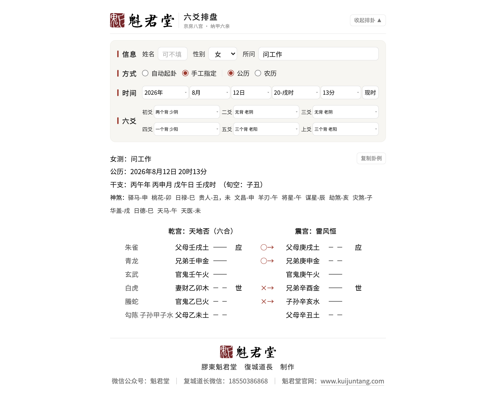

# 六爻排盘 · 文王卦单文件排盘器

**只排盘，不断卦。** 给一个时刻和六爻，排出本卦、变卦、八宫、世应、京房纳甲、六亲、六神、伏神、  
旬空与十四神煞，产出一份双击即开的单文件 HTML，以及同源的 Markdown 底本。

- 零依赖：不装天文库、不联网、不要数据库
- 单文件零外链：可整份转发、离线打开、直接打印
- 两个入口：网页面板（点选即重排）、命令行（可批量入脚本）
- 也可作 WorkBuddy 技能：放进 `~/.workbuddy/skills/` 即被 AI 调用



---

## 与网上同类工具的不同

**1. 贴进 Word 不散、不撑开。** 盘面是真 `<table>`，起卦信息区也是无边框表格。  
Word 会给 HTML **段落**套自己的段后距（改行距也改不动），对**表格**不套——所以要让信息区紧贴，只能真做成表格。

**2. 爻线既是字又是线。** DOM 里是真空字符（阳 `───`、阴 `─　─`），墨迹透明，可见线由 CSS 画。  
复制得到的是字，看到的是线；也避免了某些手机字体回退导致爻线横穿文字。

**3. 单文件离线。** 样式、脚本、数据表、logo 全内联，无任何外部请求。断网、发微信、十年后都能打开。

**4. 交互之后不变味。** 首屏由 Python 生成静态 HTML（无 JS 也能看），此后由页面内 JS 重排；  
两套引擎逐字同源，有 39 组边界用例＋农历 2486 月全量穷举盯着。

**5. 字号按盘面实测宽度直算。** 不用 `vw`（嵌 iframe 会偏）也不用 `cqw`（内核要够新），  
直接量 `getBoundingClientRect()` 算 px 写成内联样式，任何内核都生效；容器变化由 `ResizeObserver` 重算。

**6. 装进任何容器都对。** 预览面板、iframe、分屏里「容器宽 ≠ 视口宽」，CSS 容器查询兜底，JS 实测直算校正。

**7. 十四神煞全，每条有出处。** 除常见驿马、桃花、贵人、华盖，还有**谋星、日德、天马、天医**；  
三合局起法与十干口诀逐条写在 `references/规则口径.md`。

**8. 农历不存在的日期直接报错，不替你改日子。**

```
农历 2025 年闰六月只有29天，没有三十。
农历 2025 年没有闰八月（该年闰六月）。
```

日期下拉也按实有天数收口（公历依大小月闰年，农历依小月大月），根本选不出不存在的日子。

**9. 年份有明确边界。** 1900–2100，越界即报错，不静默降级。

**10. 零第三方依赖，历法以表分发。** 1900–2100 的十二节交节时刻、农历月序与闰月、日柱基准约 11 KB，  
随包分发，运行期只读表。不必 `pip install`，Windows 也不必为 C++ 扩展配编译环境。  
表值由开发期脚本用天文库重算比对，逻辑另由独立算法复核。

**11. 随机摇卦是逐枚掷钱。** 三枚一爻、六爻成卦，0/1/2/3 背 → 6/7/8/9，概率 **1/8、3/8、3/8、1/8**，  
不是四选一均匀随机；并有结构断言防止被改成「按权重直抽」。

**12. 另起一套算法校对。** 不引用本项目卦理代码，京房八宫按爻变法重推、纳甲按口诀、六亲按生克、  
伏神取本宫首卦，逐项比对（卦例 150、历法 359、神煞 1440）；四柱另做过 220,242 例穷举对照。

**13. 卦名对齐的是卦体，不是整张表。** 只算「六亲纳甲｜爻｜世应」三列的墨迹中心，本卦变卦各算各的；  
72 页扫描偏差 ≤3px（实测 0.0px）。

**14. 口径可查可改。** 晚子时（23 时归次日）默认开、可用 `--no-late-zi` 关；伏神取本宫首卦同位；  
六合／六冲／游魂／归魂括注于卦名后，八纯不括。每条依据都写在 `references/规则口径.md`。

**15. 复制与打印都替你想过。** 页顶「复制卦例」一键把信息＋卦象按富文本写入剪贴板，贴 Word 保留版式，  
钮在复制选区之外；打印／存 PDF 时操作钮自动隐藏并收回让位内距。

---

## 可以怎么用

| 场景       | 怎么用                                       |
| -------- | ----------------------------------------- |
| 自己起卦     | 开页面填所问，点「点击起卦」摇一卦；或按自己的记录逐爻选「无背／一背／二背／三背」 |
| 给人排卦     | 把排好的**整个 HTML 发过去**，对方双击就开，不用装东西          |
| 发微信      | 点「复制卦例」，粘进对话框就是一张表                        |
| 写文档 / 讲义 | 复制卦例粘进 Word、WPS，九列不散、爻线不断                 |
| 归档 / 打印  | 直接打印或存 PDF，操作钮不会印进成品                      |
| 批量出图     | 命令行一次一批，每卦一份 HTML＋MD；加 `--json` 可给别的程序用   |
| 教学       | 改任一爻即时重排，世应、六亲、伏神怎么变看得见                   |
| 校对别的软件   | 同一时刻对照四柱、旬空、纳甲、世应；口径全部写明，可据此判谁对           |
| 嵌入网页     | 按容器宽度自适应，预览面板、iframe、分屏里都不挤               |
| 手机现场     | 九列也排得下，不折行、不溢出                            |
| 离线环境     | 道观、山里、飞机上，无网也能出图转发                        |
| 二次开发     | 历法表驱动，扩年份只需重算表；加神煞改一张表（由脚本生成，勿手改）         |

---

## 安装

**当技能用**：把本目录放到 `~/.workbuddy/skills/六爻排盘/`，重启即可，无需 `pip install`。

**只用命令行**：机器有 Python 3.8+ 即可。

```bash
git clone <本仓库地址> 六爻排盘
cd 六爻排盘
python3 scripts/paipan.py --date "2026-08-12 20:13" --yao 8,6,6,7,9,9 --out out/gua
open out/gua.html      # Windows: start out\gua.html
```

**装对了没有**（不依赖浏览器与第三方库）：

```bash
python3 scripts/selfcheck.py     # 自检：144 项通过，0 项失败
python3 scripts/audit_gua.py     # 卦例 150、历法 359、神煞 1440，失败 0
```

---

## 命令行

| 参数                                      | 说明                                 |
| --------------------------------------- | ---------------------------------- |
| `--date "2026-08-12 20:13"`             | 公历时刻；或 `--now` 取当前                 |
| `--yao 8,6,6,7,9,9`                     | 六爻爻值，自初爻至上爻（6 老阴动／7 少阳／8 少阴／9 老阳动） |
| `--coins "字背背,背背背,…"`                   | 三枚钱记录：背数 0–3，或「背／字」（也认 反／正）        |
| `--order top`                           | 摇卦记录自上而下时用                         |
| `--random`                              | 代摇（输出注明「非人手摇」）                     |
| `--cal lunar --leap`                    | 以农历录入，`--leap` 为闰月                 |
| `--name 张三 --gender 女 --question "问工作"` | 起卦信息                               |
| `--no-late-zi`                          | 关闭晚子时（23 时后不归次日）                   |
| `--out out/gua`                         | 同时出 `gua.html` 与 `gua.md`          |
| `--json` / `--print-md`                 | 落盘结构化数据 / 直接回显文本                   |

---

## 目录

```
SKILL.md                    技能说明书（AI 加载入口）
scripts/lifa.py             历法：四柱、旬空、月建、农历互转（读随包表，零依赖）
scripts/gua.py              卦理：八宫、纳甲、六亲、六神、世应、伏神、变卦
scripts/shensha.py          十四神煞
scripts/render.py           HTML／MD 渲染（首屏静态产出）
scripts/engine_js.py        浏览器端引擎与面板（交互后重排）
scripts/build_tables.py     重算数据表（仅此一步需要天文库）
scripts/tables_js.py        数据表产物（勿手改）
scripts/paipan.py           命令行入口
scripts/selfcheck.py        自检（144 项断言）
scripts/audit_gua.py        独立校对（另起一套算法）
references/规则口径.md       每条起法与依据（算法唯一说明源）
assets/logo-kuijuntang.png  页脚 logo
examples/                   两套样例：静卦六列、动卦九列
```

---

## 口径速查

| 项       | 口径                              |
| ------- | ------------------------------- |
| 时区      | 北京时间（UTC+8），不做夏令时还原             |
| 年柱 / 月柱 | 立春换年、十二节换月，均按**交节时刻**，不按整日      |
| 日柱      | 连续六十甲子；23:00 起归次日（晚子时，可关）       |
| 时柱      | 五鼠遁                             |
| 旬空      | 日柱所在旬之旬首后二支                     |
| 世应      | 八宫卦序：本宫六、一世一……五世五、游魂四、归魂三；应＝世±3 |
| 伏神      | 本卦缺某六亲时，取**本宫首卦**同位之纳甲          |
| 卦类      | 六合／六冲／游魂／归魂括注于卦名后；八纯不括          |
| 神煞      | 十四项，逐条有据                        |
| 概率      | 三枚钱法 1/8、3/8、3/8、1/8，逐枚掷钱       |
| 年份      | 1900–2100，越界报错                  |

---

## 不做的事

不判吉凶、不出断语、不做「AI 解卦」；不联网、不上传、不收集数据（纯本地文件）；  
不排 1900–2100 之外的年份（宁可不排，也不给错盘）。

---

## 版权

**保留署名权，其余权利一概不保留；可商用。**

可自由复制、修改、分发、商用、闭源再分发，无需付费与申请；  
唯一条件是保留署名与来源：

```
膠東魁君堂　復城道長
https://www.kuijuntang.com
```

详见 [LICENSE](LICENSE)。

版本 1.5.0 ｜ 膠東魁君堂　復城道長　制作 ｜  道长微信：KuiJunTang  
官网：<https://www.kuijuntang.com> ｜ 微信公众号：魁君堂
